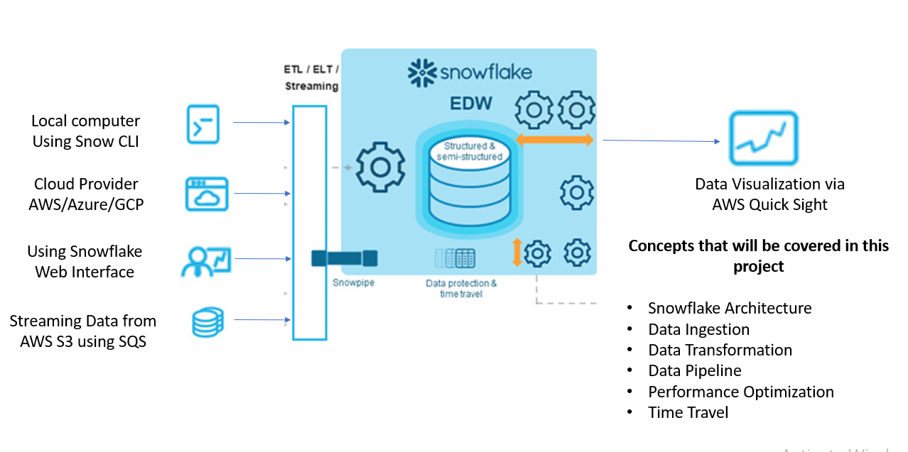
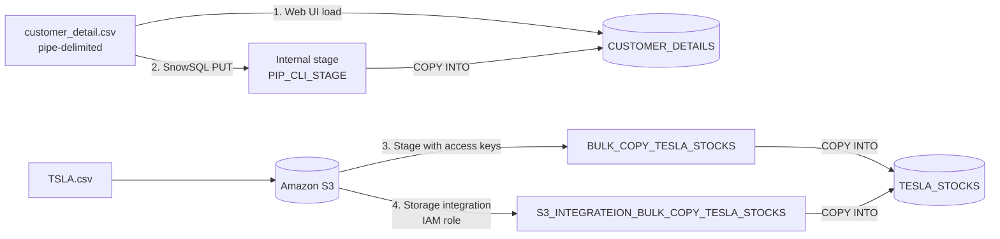

# Loading Data into Snowflake — Four Ways

A hands-on SQL walkthrough of the main ways to get files into Snowflake: the web UI, SnowSQL with an internal stage, an S3 external stage with access keys, and an S3 external stage secured with a **storage integration** (IAM role). Sample data is included.



> The overview image lists broader Snowflake topics. This repo's code covers the four loading methods below.

## Architecture



## Tech stack

Snowflake (SQL, SnowSQL CLI, stages, file formats, `COPY INTO`, storage integrations) · Amazon S3 · AWS IAM

## What it demonstrates

- **Custom file formats:** pipe-delimited and CSV, with header skipping
- **Internal stages:** `PUT` from a local machine with `auto_compress`, `LIST`, `COPY INTO … on_error = 'skip_file'`, and pattern-based loads
- **External S3 stages:** loading the Tesla stock price history into `TESLA_STOCKS`
- **Storage integration:** creating `S3_INTEGRATION`, granting usage to `SYSADMIN` and validating with `DESC INTEGRATION`, which is the secure alternative to embedding keys
- **A scoped IAM policy** (`s3 policy.txt`) limiting Snowflake to one bucket prefix

## Project structure

```
snowflake-loading-data-main/
├── snowflake intro.sql   # all four loading methods, in order
├── s3 policy.txt         # IAM policy for the Snowflake role
├── data/
│   ├── customer_detail.csv
│   ├── TSLA.csv
│   └── TSLAmodified.csv
└── img/flow.png
```

## How to run

1. Have a Snowflake account (trial is fine) and, for methods 3–4, an S3 bucket.
2. Open `snowflake intro.sql` in a Snowflake worksheet and run the sections top to bottom.
3. **Method 2:** install SnowSQL, run `snowsql`, and point the `PUT file://…` path at `data/customer_detail.csv`.
4. **Method 3:** upload `data/TSLA.csv` to your bucket and fill in `<access_key>` / `<secret_key>`. Use a throwaway IAM user for this.
5. **Method 4:**
   - create an IAM role with the policy in `s3 policy.txt` and put its ARN into the integration
   - run `DESC INTEGRATION S3_INTEGRATION` and add the returned Snowflake user ARN and external ID to the role's trust policy
   - list the stage, then copy

## Possible next steps

- Add a Snowpipe for continuous loading from the same bucket
- Use `VALIDATION_MODE` / `COPY_HISTORY` to show load error handling
- Parameterise the script with SnowSQL variables instead of `<placeholders>`
